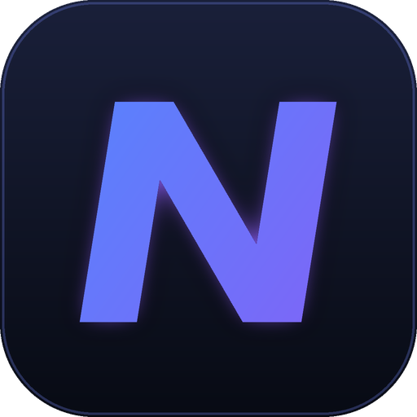

<p align="center"></p>

# NexDisk

**TR:** Windows için modern, taşınabilir (portable) bir disk ve depolama alanı analiz uygulaması.
**EN:** A modern, portable disk and storage analyzer for Windows.

> **Durum / Status:** Erken geliştirme aşaması (v0.x). Genel Bakış, Disk Analizi (treemap), Disk Sağlığı, Tarama Geçmişi ve Ayarlar çalışıyor; Büyük Dosyalar, Yinelenen Dosyalar ve Temizlik Merkezi yol haritasında.
> Early development (v0.x). Overview, Disk Analyzer (treemap), Disk Health, Scan History and Settings work; Large Files, Duplicate Finder and Cleanup Center are on the roadmap.

[](https://github.com/CasTiaL06/DiskScope/actions/workflows/ci.yml)

## Özellikler (şu an) / Features (current)

- **Genel Bakış:** toplam/kullanılan/boş alan, disk başına doluluk halkası, kategori dağılımı, en çok yer kaplayan klasörler, disk sağlığı özeti, son analizler ve son 7 günün doluluk grafiği
- **Disk Analizi:** disk veya klasörü arka planda tarar (iptal edilebilir, ilerleme gösterir); erişilemeyen klasörler raporlanır
- **Treemap:** klasör ve dosya boyutlarını iç içe ve dosya uzantısına göre renkli gösterir; üzerine gelince bilgi kartı, tıklayınca seçim, çift tıklayınca içeri girme, sağ tık menüsü
- **Disk Sağlığı:** Windows'un bildirdiği sağlık durumu; sıcaklık ve çalışma süresi okunabiliyorsa gösterilir (bazı disklerde yönetici izni gerekir, okunamazsa uydurulmaz)
- **Tarama Geçmişi:** tamamlanan analizler kalıcı saklanır, tek tıkla tekrar analiz edilebilir
- **Ayarlar:** Türkçe/İngilizce dil, Genel Bakış arka planı (hazır görseller veya kendi görselin; seçim kalıcıdır), veri klasörü
- Koyu, mavi-mor neon temalı modern tasarım ve yumuşak animasyonlar
- **Taşınabilir:** ayarlar, geçmiş ve günlükler uygulamanın yanındaki `Data` klasöründe tutulur

**Gerçek veri ilkesi:** Hiçbir ekranda örnek veri yoktur. Veri yoksa (örneğin henüz analiz yapılmadıysa) bunu açıkça söyleyen boş durum gösterilir. Doluluk grafiği, uygulamayı kullandıkça günlük kayıtla oluşur.

**Bilinen sınırlar:** boyutlar dosyaların mantıksal boyutudur (diskte kapladığı alan değil); klasör bağlantıları (junction/symlink) takip edilmez; 256 KB'den küçük dosyalar klasör başına tek blok olarak gösterilir (bellek kontrolü için).

## Yol haritası / Roadmap

Büyük dosyalar listesi · Tarama sırasında duraklatma · Yinelenen dosya bulucu · Temizlik merkezi (yalnızca kullanıcı onayıyla, Geri Dönüşüm Kutusu'na) · Dışa aktarma · Açık tema

Ayrıntılar: [`docs/DiskScope-Design-and-Plan.md`](docs/DiskScope-Design-and-Plan.md)

## Kurulum (kullanıcılar) / Install (users)

1. [Releases](../../releases) sayfasından en son `NexDisk-vX.Y.Z-win-x64-portable.zip` dosyasını indirin.
2. Zip'i bir klasöre çıkarın ve `NexDisk.exe` dosyasını çalıştırın. Kurulum ve .NET gerekmez.
3. Ayarlar ve günlükler aynı klasördeki `Data` klasörüne yazılır. Klasör yazılamıyorsa `%LOCALAPPDATA%\DiskScope\Data` kullanılır.

> Uygulama henüz imzalı değildir; Windows SmartScreen uyarı gösterebilir.

## Geliştirme / Development

Gereksinimler: Windows 10/11 (64-bit), [.NET 10 SDK](https://dotnet.microsoft.com/download) (sürüm `global.json` içinde).

```powershell
dotnet build DiskScope.sln
dotnet test DiskScope.sln
dotnet run --project src\DiskScope.App
```

Taşınabilir sürümü yerelde üretmek için:

```powershell
dotnet publish src\DiskScope.App\DiskScope.App.csproj -c Release -r win-x64 --self-contained true -p:PublishSingleFile=true -p:IncludeNativeLibrariesForSelfExtract=true -p:EnableCompressionInSingleFile=true -o publish
```

## Proje yapısı / Structure

| Proje | Görev |
|---|---|
| `src/DiskScope.Core` | Temel modeller, treemap yerleşim algoritması, boyut biçimlendirme, geçmiş mantığı |
| `src/DiskScope.Scanning` | Disk algılama, SSD/HDD tespiti, disk sağlığı, klasör tarama motoru |
| `src/DiskScope.Storage` | Ayarlar, geçmiş kayıtları, taşınabilir yol çözümleme, günlükleme |
| `src/DiskScope.App` | WPF masaüstü uygulaması (NexDisk.exe) |
| `tests/` | Birim ve entegrasyon testleri |

> Proje ve ad alanı adları (`DiskScope.*`) mimariyi korumak için değiştirilmedi; ürün adı NexDisk'tir.

## Sürüm yayınlama / Releasing

`v0.2.0` gibi bir etiket gönderildiğinde GitHub Actions testleri çalıştırır, taşınabilir zip'i üretir ve Releases sayfasına ekler:

```powershell
git tag v0.2.0
git push origin v0.2.0
```

## Lisans / License

[MIT](LICENSE)
